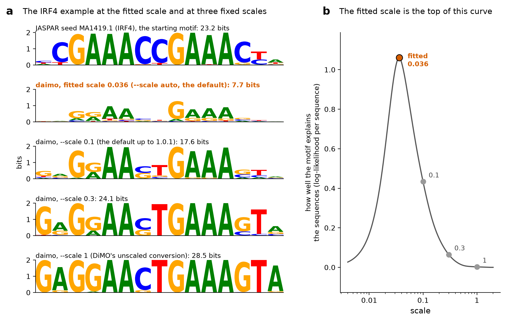

# daimo

**daimo** is a discriminative AI-powered motif optimizer. Give it a motif, a FASTA file of positive sequences and a FASTA file of negative ones, and it refines the motif so that its best sites separate the positives from the negatives. It is written in PyTorch and runs on the GPU when one is available.

The name comes from [DiMO](https://pubmed.ncbi.nlm.nih.gov/24369152/) and [DAMO](https://github.com/sx-ruan/DAMO), the two programs it builds on: the same perceptron-style update on a PWM, scored by AUC, run as a one-filter convolution so that a whole dataset is scored at once. See [How daimo differs from DiMO and DAMO](#how-daimo-differs-from-dimo-and-damo).

## Install

With [pixi](https://pixi.sh):

```bash
pixi install            # CUDA build of PyTorch
pixi install -e cpu     # CPU only
```

Or with pip:

```bash
pip install -e .
```

## Usage

```bash
pixi run daimo positive_seqs.fa.gz negative_seqs.fa.gz motif.jaspar -o motif.pwm.txt
```

Inputs are a FASTA file of positives, a FASTA file of negatives and a motif to start from, as a JASPAR matrix or a MEME file (detected from the content). Plain or gzipped files both work.

Options:

- `-i, --iterations`: maximum number of iterations (default 500).
- `-o, --output-file`: where to write the motif (`.gz` to compress). Without it, it goes to stdout.
- `--oformat`: `pwm` (default), `jaspar` or `meme`. See [Output formats](#output-formats).
- `-d, --debugging`: use only the first 1,000 sequences of each file.
- `-w, --widths`: the widths to try, as a list in the style of `cut -f` (`8,10,12`, `5-19`, `5-8,12,15-`); default: the width of the seed (see [Motif width](#motif-width)).
- `-m, --motif`: which motif to use when a MEME file has several, by name or by ID (e.g. `MA1419.1`). Not needed for single-motif files. MEME matrices are probabilities, so 1e-4 is added and the columns renormalized before taking the log, as DAMO does for the PFMs it builds.
- `--scale`: with `--oformat jaspar` or `meme`, the factor applied to the PWM before converting it to frequencies: `auto` (default), which fits it to the sequences; `seed`, which gives the motif the information content of the seed; or a positive number. See below.

The `AUC optimized from ... to ...` line is printed to stdout too, so use `-o` to keep the motif on its own.

To try it on the bundled example (an IRF4 motif):

```bash
pixi run example        # writes results/MA1419.1.pwm.txt
```

## Output formats

The input format is detected from the file. The output format is set with `--oformat`:

- `pwm` (default): the log PWM, one line per motif position with four columns (A, C, G, T).
- `jaspar`: frequencies (not counts) as a JASPAR matrix.
- `meme`: frequencies as a MEME file, laid out as ExplaiNN-2 writes it (`nsites` is a placeholder).

For `jaspar` and `meme` the PWM weights are scaled (`--scale`), read as energies in kT and converted with a Boltzmann distribution (a softmax over A, C, G and T at each position), as in DiMO. The motif keeps the name of the seed: the JASPAR ID and name, or the MEME `MOTIF` line.

daimo optimizes the PWM so that it ranks positives above negatives, and a ranking does not change when every weight is multiplied by the same number. So the size of the weights is arbitrary, and it keeps growing while daimo runs: at a fixed scale, the sharpness of the frequency matrix depends on the number of iterations. On the IRF4 example, the motif written at scale 0.1 has 4.9, 10.4, 14.3 and 16.9 bits after 25, 50, 75 and 100 iterations, while the AUC stays at 0.72.

By default (`--scale auto`) the scale is therefore fitted to the sequences: daimo takes the scale at which the frequency matrix best describes the positive sequences as a probability model (maximum likelihood; each sequence has no site or one, on either strand, and the rest follows the base composition of the negatives). On the same four checkpoints the fitted motif has 7.5, 7.7, 7.8 and 7.8 bits. The fit uses the sequences daimo was run on (at most 10,000 positives, a fixed sample beyond that), takes a few seconds, and the fitted scale and the fraction of sequences with a site are reported on stderr after the motif is written.



The figure shows what the scale does on the IRF4 example (first 1,000 sequences of each file, `-d`). The optimized PWM is the same in the four daimo logos (**a**): only the scale changes, and the motif goes from 7.7 bits at the fitted scale (0.036) to 28.5 bits, nearly one-hot, at scale 1. The fitted scale is the one at which the motif best explains the positive sequences (**b**); the sharper motifs at 0.1, 0.3 and 1 explain them worse, because real sites do not match the consensus that closely.

`--scale seed` gives the optimized motif the sharpness of the motif it was started from: daimo takes the scale at which the motif has the same information content (bits) as the seed. Only the seed columns that were optimized count. With `-w`, a narrower motif starts from the most informative columns of the seed (see [Motif width](#motif-width)), so if the seed has 19 columns and daimo keeps 9 of them, the motif gets the bits of those 9 columns, not of the 19; columns added to the seed have no information, so a wider motif gets the bits of the whole seed. Which base each position prefers is not changed, only how sharp the columns are. The scale and the bits matched are reported on stderr after the motif is written. Use it when the motif should stay comparable to its seed, or when the positives differ only weakly from the negatives, where the fitted scale gives a flat motif. A seed with no information in those columns has nothing to match, and the scale is then fitted to the sequences as with `auto`.

`--scale` with a number uses that scale instead: above 1 sharpens the columns and below 1 flattens them. `--scale 0.1` gives the output of daimo 1.0.1, where it was the default. `--scale 1` is DiMO's unscaled conversion, which gives nearly one-hot columns because the optimized weights are large (about -290 to +32 on the IRF4 example). Information content is only comparable between motifs written with the fitted scale, or with the same number after the same number of iterations; with `--scale seed` it is that of the seed by construction. The `pwm` format is not affected by the scale.

## Motif width

By default the motif keeps the width of the seed. You choose which widths to explore, and daimo picks the best one:

```bash
pixi run daimo pos.fa.gz neg.fa.gz motif.jaspar -w 5-19 -o motif.pwm.txt       # every width from 5 to 19
pixi run daimo pos.fa.gz neg.fa.gz motif.jaspar -w 8,10,12 -o motif.pwm.txt
pixi run daimo pos.fa.gz neg.fa.gz motif.jaspar -w 5-8,12,15- -o motif.pwm.txt
```

`-w, --widths` takes a list like `cut -f`: `N`, `N-M`, `-M` (1 to M) and `N-` (N up to the sequence length), separated by commas.

- 20% of the sequences of each class are held out (fixed seed).
- For each width the seed is cut to its most informative run of columns (the highest total information content), or padded with uniform columns (half on each side), and optimized on the other 80%. The seed's own width is always tried too. Widths longer than the sequences are skipped.
- Each result is scored on the held-out sequences, and the smallest width within 0.002 AUC of the best one wins, so extra columns have to pay for themselves.
- The widths and their held-out AUCs are printed, with the chosen one marked.

The returned motif is optimized on the 80% only, and its held-out AUC was also used to pick the width, so that number is slightly optimistic, and more so the more widths you try. Each width is a full optimization, so the run takes about as long as that many separate runs. Cutting the seed keeps one run of columns, so a motif with a gap (two half-sites with a spacer) can lose a half-site at a small width.

## Python API

```python
from daimo.damo import damo

pwm = damo("positive_seqs.fa.gz", "negative_seqs.fa.gz", "motif.jaspar", iterations=500)
pwm = damo("positive_seqs.fa.gz", "negative_seqs.fa.gz", "motif.jaspar", widths="5-19")
```

`pwm` is a NumPy array of shape (4, motif length), the log PWM with rows A, C, G and T. `widths` is a string like `cut -f` or a list of ints. `daimo.damo.pwm_to_pfm(pwm, scale)` converts a PWM to frequencies, `daimo.damo.fit_scale(pwm, positive_seqs, negative_seqs)` fits that scale to sequences given as strings (what `--scale auto` does), and `daimo.damo.match_scale(pwm, seed_pwm)` returns the scale that matches the information content of the seed, with `seed_pwm` as `daimo.io.read_pwm` reads it (what `--scale seed` does).

## How daimo differs from DiMO and DAMO

daimo implements DiMO's optimization on a mononucleotide PWM (which is also level 1 of DAMO), with its own way of choosing the width.

- **No dinucleotide terms.** DAMO can add adjacent-dinucleotide interactions (`-i` in DAMO.py). daimo has only the PWM.
- **You set the widths to explore; there is no flexible width search.** DiMO's width optimization (section 2.6 of the [paper](https://pubmed.ncbi.nlm.nih.gov/24369152/)) pads the motif to about 20 columns, cuts it to the central 6 and restores columns one at a time while each adds at least 0.3% AUC on held-out sequences. DAMO.py's command line has no width option. daimo does neither: you give the list of widths (`--widths 5-19`), each one is optimized, and the best held-out AUC wins. On the IRF4 example, the DiMO-style procedure picked 8 columns and lost held-out AUC (0.668, against 0.712 at the seed width), because the signal is spread over many columns and it stops at the first column that does not pay.
- **PyTorch, and the GPU.** The PWM is a one-filter convolution followed by a max pool, so all sequences are scored in one batch on CUDA or Apple's MPS, or on the CPU. DAMO.py is Python 2.7 with NumPy, SciPy and scikit-learn.
- **Inputs and outputs.** Seeds are JASPAR matrices or MEME files (detected from the content, gzipped or not), where DAMO.py reads its own PFM text format. The output is the log PWM, or frequencies as JASPAR or MEME with the scale described above (fitted to the sequences by default). DiMO converts its PWM to a PFM without scaling (section 2.7 of the paper), which is `--scale 1`.
- **Same update, same learning rates.** The update uses the overlap zone between the first negative and the last positive, with learning rates 1, 0.55 and 0.1, and stops when none improves the AUC. The default of 500 iterations follows DAMO.py (the paper's default is 150 epochs).
- **Seed pseudocounts.** The seed PWM gets Biopython's JASPAR pseudocounts, not DAMO's.
- **Sequences.** All sequences in an input file must have the same length. Windows that overlap an `N` are scored with the `N` as zeros, not skipped.

## Tests

```bash
pixi run test
```

The one-hot encoding in `daimo/sequence.py` is copied from ExplaiNN, so both packages encode sequences the same way.

## References

- Patel RY, Stormo GD. Discriminative motif optimization based on perceptron training. Bioinformatics (2014). [PubMed](https://pubmed.ncbi.nlm.nih.gov/24369152/)
- Ruan S, Stormo GD. Comparison of discriminative motif optimization using matrix and DNA shape-based models. BMC Bioinformatics (2018). The DAMO implementation is at <https://github.com/sx-ruan/DAMO>.
